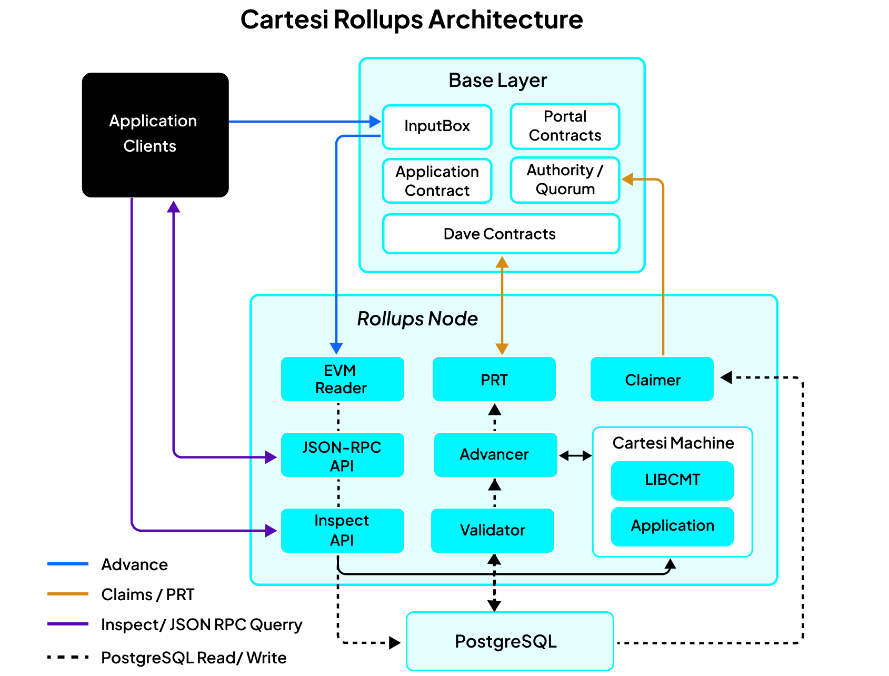
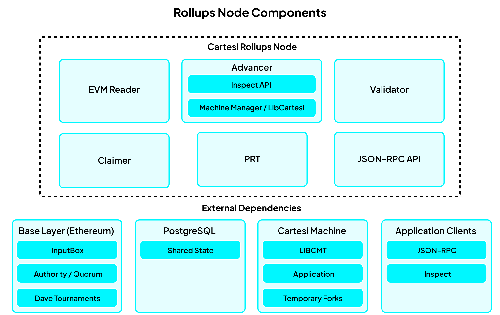

<br>
<p align="center">
    
</p>
<br>

# Cartesi Rollups Node

[](https://github.com/cartesi/rollups-node/releases)
[](https://github.com/cartesi/rollups-node/actions/workflows/build.yml)
[](LICENSE)

Cartesi Rollups Node is the reference middleware connecting Cartesi Rollups contracts, application back ends running inside Cartesi Machines, and application clients. It reads on-chain inputs, advances application state, stores outputs, reports, claims, and proofs in PostgreSQL, submits claims when enabled, and exposes JSON-RPC and Inspect APIs for querying application state.

> [!IMPORTANT]
> Before upgrading, review [GitHub Releases](https://github.com/cartesi/rollups-node/releases) and compare the target release with the version currently deployed. Use compatible node, Cartesi Machine emulator, CLI, snapshot, and proof-tool versions throughout a deployment.

<details>
<summary><strong>Table of contents</strong> — click to expand</summary>

<br>

- [Overview](#overview)
- [Quick start](#quick-start)
- [Installation](#installation)
- [Running a node](#running-a-node)
- [Configuration](#configuration)
- [HTTP APIs and ports](#http-apis-and-ports)
- [Operations](#operations)
- [CLI and tools](#cli-and-tools)
- [Architecture and repository layout](#architecture-and-repository-layout)
- [Development](#development)
- [Contributing](#contributing)
- [Security](#security)
- [License](#license)
- [Related projects and support](#related-projects-and-support)

</details>

## Overview

The node connects four parts of a Cartesi Rollups deployment:

- **Base layer (for example, Ethereum):** provides application inputs, settlement, and consensus contracts.
- **Cartesi Machine:** executes an application's back end deterministically.
- **PostgreSQL:** stores applications, inputs, outputs, reports, epochs, claims, proofs, and operational state.
- **Application clients:** submit inputs through the base layer, query indexed state through JSON-RPC, and send read-only requests through the Inspect API.



Advance requests are submitted to the on-chain `InputBox`, read by the node, executed by the application machine, and persisted with their outputs and reports. The validator computes epoch claims and output proofs. The claimer submits Authority or Quorum claims, while the PRT service participates in Dave tournaments.

Inspect requests follow a separate path. They are sent directly to the node, executed on a temporary fork of the application's current machine, and returned synchronously without changing canonical machine or database state.

## Quick start

The local stack uses Docker Compose and contains an Anvil development chain, PostgreSQL 18, the database migration job, and the standalone node.

```sh
make image
make devnet
docker compose up -d
until curl --fail --silent http://localhost:10000/readyz; do sleep 1; done
```

Inspect the stack or follow its logs with:

```sh
docker compose ps
docker compose logs -f node
```

This starts the infrastructure but does not build, deploy, or register an application. Use [Cartesi CLI](https://github.com/cartesi/cli) to build an application machine. Then either use `cartesi-rollups-cli deploy application` to deploy a new application contract and register it automatically, or use `cartesi-rollups-cli app register` with the address of an application contract that is already deployed.

Remove the local containers and their volumes when finished:

```sh
docker compose down -v
```

## Installation

### Runtime requirements

- Linux on amd64 or arm64 for the provided container and Debian workflows
- The Cartesi Machine emulator release the node package depends on (0.21.x for v2.0.0-alpha.13; the Debian package declares the exact range)
- PostgreSQL; version 18 is used by development and CI
- An Ethereum JSON-RPC HTTP endpoint
- A funded, authorized signer when claim submission is enabled

### Debian package

The release workflow publishes amd64 and arm64 packages. Choose a node release and its compatible Cartesi Machine emulator release, then replace the values below before installing:

```sh
VERSION="<node-version>"
EMULATOR_VERSION="<compatible-emulator-version>"
ARCH="$(dpkg --print-architecture)"

curl -fLO "https://github.com/cartesi/machine-emulator/releases/download/v${EMULATOR_VERSION}/machine-emulator_${ARCH}.deb"
curl -fLO "https://github.com/cartesi/rollups-node/releases/download/v${VERSION}/cartesi-rollups-node-v${VERSION}_${ARCH}.deb"

sudo apt install "./machine-emulator_${ARCH}.deb"
sudo apt install "./cartesi-rollups-node-v${VERSION}_${ARCH}.deb"
```

See [GitHub Releases](https://github.com/cartesi/rollups-node/releases) for available versions and artifacts.

### Docker image

The repository currently builds a local development image rather than a published 2.0 release image:

```sh
make image
docker run --rm cartesi/rollups-node:devel cartesi-rollups-node --version
```

### From source

Source builds require Go 1.27.1 or later, GNU Make, a C toolchain, `pkg-config`, OpenSSL development files, and Cartesi Machine emulator headers and libraries.

```sh
git clone https://github.com/cartesi/rollups-node.git
cd rollups-node
make build
sudo make install
```

## Running a node

### Standalone mode

`cartesi-rollups-node` starts the EVM reader, advancer, validator, claimer, PRT service, JSON-RPC API, and Inspect API in one process. This is the simplest deployment model and is used by the repository's root [`compose.yaml`](compose.yaml) development stack.

The following example shows the minimum shape of a live-network configuration. Supply deployment-specific values through the referenced shell variables before running it.

```sh
export CARTESI_BLOCKCHAIN_HTTP_ENDPOINT="${ETHEREUM_RPC_URL:?set ETHEREUM_RPC_URL}"
export CARTESI_BLOCKCHAIN_ID="${CHAIN_ID:?set CHAIN_ID}"
export CARTESI_DATABASE_CONNECTION="${DATABASE_URL:?set DATABASE_URL}"
export CARTESI_AUTH_KIND=mnemonic
export CARTESI_AUTH_MNEMONIC_FILE=/run/secrets/cartesi_mnemonic
export CARTESI_PRT_AUTH_KIND=mnemonic
export CARTESI_PRT_AUTH_MNEMONIC_FILE=/run/secrets/cartesi_mnemonic

cartesi-rollups-cli db init
```

The node only processes an application after its contract exists on the configured chain and the application is registered in the node database. Choose one of the following workflows.

To deploy a new application contract and register it in one command, configure the deployed InputBox and self-hosted application factory addresses, then run:

```sh
export CARTESI_CONTRACTS_INPUT_BOX_ADDRESS="${INPUT_BOX_ADDRESS:?set INPUT_BOX_ADDRESS}"
export CARTESI_CONTRACTS_SELF_HOSTED_APPLICATION_FACTORY_ADDRESS="${SELF_HOSTED_APPLICATION_FACTORY_ADDRESS:?set SELF_HOSTED_APPLICATION_FACTORY_ADDRESS}"

cartesi-rollups-cli deploy application \
  my-app \
  "${APPLICATION_SNAPSHOT:?set APPLICATION_SNAPSHOT}"
```

By default, this deploys the application with a new Authority consensus contract, registers it in the database, and enables it. Alternatively, if a compatible application contract is already deployed on the configured chain, register its address directly:

```sh
cartesi-rollups-cli app register \
  --name my-app \
  --address "${APPLICATION_ADDRESS:?set APPLICATION_ADDRESS}" \
  --template-path "${APPLICATION_SNAPSHOT:?set APPLICATION_SNAPSHOT}"
```

The registration command reads application and consensus information from the deployed contract. After completing either workflow, start the node:

```sh
cartesi-rollups-node
```

Other deployment modes, such as using an existing consensus contract or deploying a PRT application, require the corresponding factory or consensus options; run `cartesi-rollups-cli deploy application --help` for details. To run without signing or submitting transactions, set `CARTESI_FEATURE_CLAIM_SUBMISSION_ENABLED=false`; no funded signer is then required.

### Multi-process mode

Each service is also available as an individual `cartesi-rollups-*` binary. Use this mode when services need separate resource limits, failure domains, or scaling policies. All processes coordinate through the same PostgreSQL database.

[`compose.individual-services.yaml`](compose.individual-services.yaml) illustrates a split deployment for the EVM reader, advancer, validator, claimer, PRT service, and JSON-RPC API.

## Configuration

The node is primarily configured through `CARTESI_*` environment variables. Service binaries expose corresponding command-line flags for common settings; use `<binary> --help` for the flags supported by that binary.

| Variable                                   | Purpose                                          | Default                                   |
| ------------------------------------------ | ------------------------------------------------ | ----------------------------------------- |
| `CARTESI_BLOCKCHAIN_HTTP_ENDPOINT`         | Ethereum JSON-RPC endpoint                       | Required                                  |
| `CARTESI_BLOCKCHAIN_ID`                    | Expected chain ID                                | Required                                  |
| `CARTESI_DATABASE_CONNECTION`              | PostgreSQL connection URL                        | PostgreSQL driver defaults                |
| `CARTESI_AUTH_KIND`                        | Claimer signer: `private_key`, `mnemonic`, or `aws` | `mnemonic`                             |
| `CARTESI_PRT_AUTH_KIND`                    | PRT signer, same kinds; must be a different address from the claimer | `mnemonic`        |
| `CARTESI_PRT_AUTH_MNEMONIC_ACCOUNT_INDEX`  | Mnemonic account used by the PRT signer          | `6`                                       |
| `CARTESI_FEATURE_CLAIM_SUBMISSION_ENABLED` | Submit claims and PRT transactions; saved at first start, cannot be changed on an existing database | `true` |
| `CARTESI_SNAPSHOTS_DIR`                    | Machine snapshot directory                       | `/var/lib/cartesi-rollups-node/snapshots` |
| `CARTESI_BLOCKCHAIN_DEFAULT_BLOCK`         | Block tag followed by chain readers; saved at first start, cannot be changed on an existing database | `finalized` |
| `CARTESI_LOG_LEVEL`                        | Global `debug`, `info`, `warn`, or `error` level | `info`                                    |
| `CARTESI_JSONRPC_MAX_INFLIGHT`             | Concurrent JSON-RPC request limit                | `64`                                      |
| `CARTESI_INSPECT_MAX_INFLIGHT`             | Concurrent Inspect request limit                 | `64`                                      |

The endpoint, HTTP authorization header, database connection, mnemonic, and private key settings support generated `*_FILE` variants, for both the claimer (`CARTESI_AUTH_*`) and the PRT signer (`CARTESI_PRT_AUTH_*`). For example, use `CARTESI_AUTH_KIND=mnemonic` with `CARTESI_AUTH_MNEMONIC_FILE=/path/to/secret`; the file source does not change the authentication kind. The standalone node always starts the PRT service, so a PRT signer is required whenever claim submission is enabled, even for Authority or Quorum applications.

`make env` prints the local development settings. Generate the complete configuration reference locally with:

```sh
make generate-config-docs
```

The generated reference is written to `docs/config.md` and is intentionally not committed.

## HTTP APIs and ports

The standalone process exposes three HTTP surfaces:

| Default port | Surface  | Paths               | Recommended exposure   |
| -----------: | -------- | ------------------- | ---------------------- |
|        10000 | Health   | `/livez`, `/readyz` | Internal only          |
|        10011 | JSON-RPC | `/rpc`              | Behind a reverse proxy |
|        10012 | Inspect  | `/inspect/{dapp}`   | Behind a reverse proxy |

In multi-process mode, each service also exposes its own health port:

| Service      | Health port | Additional API port |
| ------------ | ----------: | ------------------: |
| EVM reader   |       10001 |                   — |
| Advancer     |       10002 |     10012 (Inspect) |
| Validator    |       10003 |                   — |
| Claimer      |       10004 |                   — |
| JSON-RPC API |       10005 |               10011 |
| PRT          |       10006 |                   — |

All HTTP services bind to all interfaces by default. Production deployments should restrict them with private networking or a firewall and place JSON-RPC and Inspect behind a reverse proxy that provides TLS, authentication, and rate limiting. See the [HTTP deployment posture](docs/http-posture.md) for request limits, CORS, timeouts, and proxy guidance.

API references:

- [JSON-RPC API overview and methods](https://docs.cartesi.io/cartesi-rollups/2.0/api-reference/jsonrpc/overview/)
- [Inspect OpenAPI specification](api/openapi/inspect.yaml)

## Operations

### Health checks

- `/livez` reports whether the process and its managed services are alive.
- `/readyz` reports whether they are ready to serve work.

The current health server does not expose a metrics endpoint.

### State and backups

PostgreSQL is the authoritative store for indexed and operational state. Machine snapshots are written beneath `CARTESI_SNAPSHOTS_DIR`. Back up the database and snapshot directory together, and verify that registered application template paths remain available after restoration.

The container image runs as the unprivileged `cartesi` user and creates `/var/lib/cartesi-rollups-node/{snapshots,data,logs}`. Mount any directory that must survive container replacement; the default development Compose file is not a production backup strategy.

### Logging

Set the global level with `CARTESI_LOG_LEVEL`. Override individual services with:

- `CARTESI_LOG_LEVEL_ADVANCER`
- `CARTESI_LOG_LEVEL_CLAIMER`
- `CARTESI_LOG_LEVEL_EVM_READER`
- `CARTESI_LOG_LEVEL_JSONRPC_API`
- `CARTESI_LOG_LEVEL_PRT`
- `CARTESI_LOG_LEVEL_VALIDATOR`

### Upgrading

Back up PostgreSQL and machine snapshots, identify the target version in [GitHub Releases](https://github.com/cartesi/rollups-node/releases), compare its tag with the currently deployed version, and install the emulator version required by the target package. Upgrade and validate the database schema with:

```sh
cartesi-rollups-cli db init --upgrade
cartesi-rollups-cli db check-version
```

## CLI and tools

### `cartesi-rollups-cli`

| Command group                               | Purpose                                                                                                                                |
| ------------------------------------------- | -------------------------------------------------------------------------------------------------------------------------------------- |
| `app`                                       | List, register, and remove applications; change enabled status with `app status`; manage configuration with `app execution-parameters` |
| `db`                                        | Initialize, upgrade, and validate the database schema                                                                                  |
| `deploy`                                    | Deploy applications and Authority or Quorum consensus contracts                                                                        |
| `deposit erc20`                             | Deposit ERC-20 tokens through the ERC-20 portal                                                                                        |
| `send`                                      | Submit a generic application input                                                                                                     |
| `inspect`                                   | Call the Inspect API                                                                                                                   |
| `execute`, `validate`                       | Execute vouchers and validate notices on-chain                                                                                         |
| `read`                                      | Read epochs, inputs, outputs, reports, commitments, tournaments, matches, match advances, and withdrawals                              |
| `contract`                                  | Experimentally query on-chain contract state directly                                                                                  |
| `foreclose`, `prove-drive-root`, `withdraw` | Perform the application foreclosure and withdrawal workflow                                                                            |
| `refund`                                    | Refund a deposit that was not finalized before the application was foreclosed                                                          |

Run `cartesi-rollups-cli --help` or generate the complete command reference with `make generate-cli-docs`. For the complete foreclosure and withdrawal workflow, see the [Emergency Withdrawal Recovery Guide](https://docs.cartesi.io/cartesi-rollups/2.0/development/emergency-withdrawal/recovery-guide/).

### `cartesi-rollups-machine-tool`

- `replay` replays accepted database inputs into a machine template and stores the resulting machine.
- `prove accounts-drive` generates an accounts-drive root proof and an account withdrawal proof from a stored snapshot.

Run `cartesi-rollups-machine-tool --help` for all required flags. Use the machine tool from the same release as the node because snapshot and proof formats may change together.

## Architecture and repository layout

In standalone mode, the supervisor runs six logical services. The Inspect API and machine manager belong to the advancer. PostgreSQL, the base layer, application clients, and the Cartesi Machine remain external dependencies.



`libcartesi` is the host-side Cartesi Machine emulator library used by the advancer's machine runtime. `libcmt` is different: it is linked into the application and runs inside the Cartesi Machine guest.

The repository separates executable entry points from internal service implementations and reusable Go packages. Its main top-level directories are:

```text
cmd/        entry points for the node, service binaries, CLI, and machine tool
internal/   node services, configuration, machine manager, models, and repositories
pkg/        reusable emulator, machine, contract, JSON-RPC, and Inspect packages
test/       integration tests, devnet, test applications, and test tooling
docs/       maintained references and README image assets
```

Reusable Go packages include:

- `pkg/emulator`: CGo bindings for the Cartesi Machine emulator APIs
- `pkg/machine`: machine runtime abstractions and computation-hash support
- `pkg/contracts`: generated Go bindings for Rollups contracts
- `pkg/jsonrpc`: JSON-RPC client support
- `pkg/inspectclient`: generated Inspect API client
- `pkg/ethutil`: Ethereum helpers shared by the services and the CLI
- `pkg/service`: the service lifecycle framework used by every binary

## Development

Host builds and full CLI documentation generation require the source-build dependencies listed under [From source](#from-source). Host linting additionally requires `golangci-lint` on `PATH`.

```sh
make build
make lint
make docs
```

Host unit tests require the local Anvil devnet, test database, and development environment variables:

```sh
make devnet
eval "$(make env)"
make start
make test
make stop
```

For containerized tests and linting, build both required local images first:

```sh
make devnet
make tester-image
make unit-test-with-compose
make lint-with-docker
make integration-test-with-compose
```

The first Compose test run downloads large Cartesi Machine test images, and the complete integration suite may take significant time. `make devnet` also runs `clean-contracts` before rebuilding, so regenerate locally downloaded contract artifacts with `make contracts` if needed.

Use `make help` to list the available targets. Integration tests support both standalone and multi-process topologies; see the comments and targets in the [Makefile](Makefile) for `NODE_TOPOLOGY`, `SHARD`, and `PARALLEL` options.

The project follows [Conventional Commits](https://www.conventionalcommits.org/) and uses [cocogitto](https://github.com/cocogitto/cocogitto). Tags use the `v*` convention. Tagged releases publish Debian packages; CI-built Docker images are development and test artifacts rather than stable release images.

## Contributing

Read [CONTRIBUTING.md](CONTRIBUTING.md) and the [CHANGELOG](CHANGELOG.md) before opening a pull request, and follow the [Code of Conduct](CODE_OF_CONDUCT.md) in all project interactions. Credited authors are listed voluntarily in [AUTHORS](AUTHORS); the Git history and [GitHub contributors](https://github.com/cartesi/rollups-node/graphs/contributors) provide the broader contribution record.

## Security

Do not open a public issue, pull request, or discussion for a security problem. Report it privately by email to [rollups@cartesi.foundation](mailto:rollups@cartesi.foundation) with the affected component and version, the impact and who is affected, and steps to reproduce. Email is not encrypted, so say so in the first message if the report contains sensitive material. The full policy, together with the published security reviews of the stack, is on the [Audit reports](https://docs.cartesi.io/get-started/audit-reports/) page.

Keep mnemonic and private-key material out of environment dumps and command histories. Prefer the supported `*_FILE` settings or AWS KMS, restrict secret-file permissions, and avoid funding the node signer with more value than its role requires.

## Related projects and support

- [Cartesi CLI](https://github.com/cartesi/cli): builds and runs Cartesi applications
- [Rollups contracts](https://github.com/cartesi/rollups-contracts): on-chain application and consensus contracts
- [Cartesi Machine emulator](https://github.com/cartesi/machine-emulator): deterministic application execution
- [Dave](https://github.com/cartesi/dave): permissionless fraud-proof system and PRT contracts
- [Rollups Explorer](https://github.com/cartesi/rollups-explorer): client for Cartesi Rollups Node 2.0
- [Application templates](https://github.com/cartesi/application-templates): starter projects used by Cartesi CLI

Join the [Cartesi Discord](https://discord.gg/cartesi) to discuss the node with users and maintainers. Use [GitHub Issues](https://github.com/cartesi/rollups-node/issues) for reproducible bugs and feature requests, including the node version, relevant sanitized logs, deployment mode, and non-secret configuration details.

## License

Cartesi-authored source code in this repository is licensed under the [Apache License 2.0](LICENSE). Distributed artifacts include third-party components under additional licenses; review [THIRD_PARTY_LICENSES.md](THIRD_PARTY_LICENSES.md) before redistribution.
